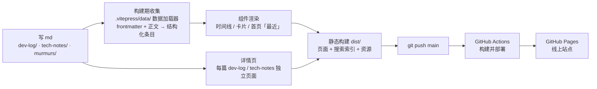

# 琥珀流光的数字花园

个人站点，记录独立游戏开发、开发日志与技术沉淀。纯静态站点，构建后由 GitHub Pages 托管，无后端、无数据库。

线上地址：<https://hupoliuguang.github.io>

## 技术栈

| 项 | 版本 |
|---|---|
| Node.js | 24.x（CI 与本地保持一致） |
| pnpm | 11.6.0（版本写死在 workflow 里） |
| VitePress | 1.6.x |
| Vue | 3.5.x |
| TypeScript | 5.9.x |

> TypeScript 固定在 5.x：`vue-tsc` / Volar 目前不支持 TS 7 的原生编译器。

## 目录结构

```
.
├─ .github/workflows/deploy.yml   # push main → 构建 → 发布 Pages
├─ .vitepress/
│  ├─ config.ts                   # 站点配置：导航、搜索、音频扫描
│  ├─ data/                       # 构建期数据加载（自动收集 md）
│  └─ theme/                      # 主题：布局、组件、样式
├─ dev-log/                       # 开发日志（生成详情页 + 时间线）
├─ tech-notes/                    # 技术思考（生成详情页 + 卡片列表）
├─ murmurs/                       # 碎碎念（只做时间线数据，不生成页面）
├─ examples/                      # 写作模板（不参与构建）
├─ public/                        # 静态资源，原样拷贝到站点根
├─ scripts/new.mjs                # 新建文章的脚手架
├─ index.md                       # 首页
├─ dev-log.md / tech-notes.md / world-murmur.md / works.md   # 栏目骨架页
└─ package.json / pnpm-lock.yaml / tsconfig.json
```

## 内容如何变成网页（先收集，后发布）

这个站点是"先收集、后发布"的模式：md 是唯一内容源，构建期由数据层自动收集成结构化条目，发布由 `git push` 触发，全程无后端、无数据库。



要点：

- **新增文章零代码改动**：列表、首页「最近」、搜索索引都由构建期自动收集生成，不用手改导航；
- **发布即提交**：推送 main 后由 Actions 自动构建部署，构建失败不影响线上已有版本；
- **搜索是构建期生成的静态索引**，浏览器本地检索，无后端请求。

## 本地开发

```bash
pnpm install      # 安装依赖
pnpm docs:dev     # 本地预览 http://localhost:5173，改 md 自动热更新
pnpm docs:build   # 完整构建，产物在 .vitepress/dist
pnpm docs:preview # 预览构建产物
```

Windows PowerShell 注意两点：

- 执行策略可能是 `Restricted`，直接敲 `pnpm` 会报"禁止运行脚本"，改用 `pnpm.cmd`；
- 路径变更后需要新开终端（或重启编辑器）才会生效。

## 内容约定

三个内容目录由 [.vitepress/data/](.vitepress/data) 在构建期自动收集，**新增文章不需要手改导航或列表**。

| 目录 | 文件名规则 | frontmatter | 产物 |
|---|---|---|---|
| `dev-log/` | `YYYY-MM-DD-标题.md` | `title`、`date`、`tags` | 详情页 + 首页"最近" + 时间线 |
| `tech-notes/` | `标题.md` | `title`、`date`、`tags` | 详情页 + 卡片列表 + 预览目录 |
| `murmurs/` | `YYYY-MM-DD.md` | `date`（`title` 可省） | 仅碎碎念时间线 |

frontmatter 示例：

```yaml
---
title: 站点重构
date: 2026-10-27
tags: [CI]
---
```

- `date` 决定所有列表的排序，必须写；
- `tags` 用数组写法，显示为标签；
- `murmurs/` 里的文件不会生成独立页面（`srcExclude` 排除），引用时只能走时间线。

## 新建文章

方式一：编辑器命令面板（推荐）

`Ctrl+Shift+P` → `Tasks: Run Task` → 选择「新建：开发日志 / 技术思考 / 碎碎念」，按提示填标题、标签和日期（日期留空 = 今天）。

方式二：命令行

```bash
pnpm new:log "标题" --tags "Unity,战斗"
pnpm new:note "标题" --tags "架构"
pnpm new:murmur "标题"          # 标题可省略
```

日期默认当天；补写旧文章时用 `--date YYYY-MM-DD` 指定（任务面板和命令行都支持）：

```bash
pnpm new:log "站点重构" --date 2026-10-27 --tags "CI"
```

## 发布

```bash
git add dev-log tech-notes murmurs
git commit -m "docs: 新增文章"
git push
```

推送到 `main` 后由 Actions 自动构建部署，无需手动发布；构建失败不会影响线上已有版本。

## 几个容易踩的约定

- **骨架页不参与搜索**：`dev-log.md`、`tech-notes.md`、`world-murmur.md`、`works.md` 只有 frontmatter，已加 `search: false`，否则搜索结果里会出现空条目。
- **新增内容目录要同步三处**：`config.ts` 的 `srcExclude` / `nav`、`.vitepress/data/` 的 loader、以及 `scripts/new.mjs` 的 `types`。
- **pnpm 11 的发布年龄策略**：依赖发布不满 24 小时会被 `minimumReleaseAge` 拦下，`pnpm install` 直接失败。新加依赖时优先选已发布一段时间的版本。
- **构建脚本白名单**：`pnpm-workspace.yaml` 里的 `allowBuilds` 只放行 `esbuild`；新增需要 postinstall 的依赖时要把包名加进去。
- **临时文件**：`*.timestamp-*.mjs` 是 Vite 编译配置的产物，已在 `.gitignore` 中忽略。
- **README 本身不参与构建**：`srcExclude` 已排除 `README.md`，避免生成多余的 `/README.html`。

## 许可

内容版权归作者所有；站点配置与代码可参考，转载请注明出处。
